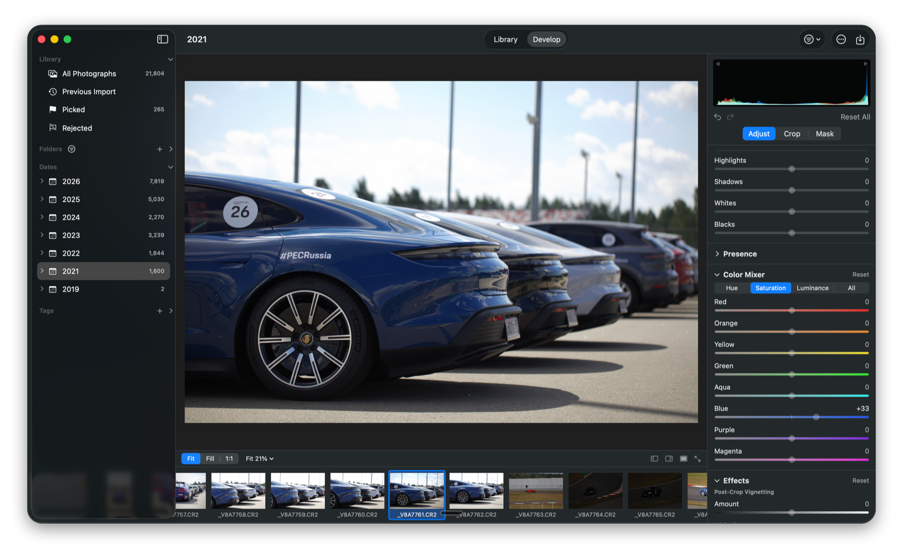
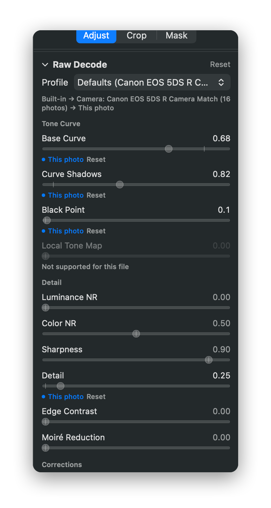
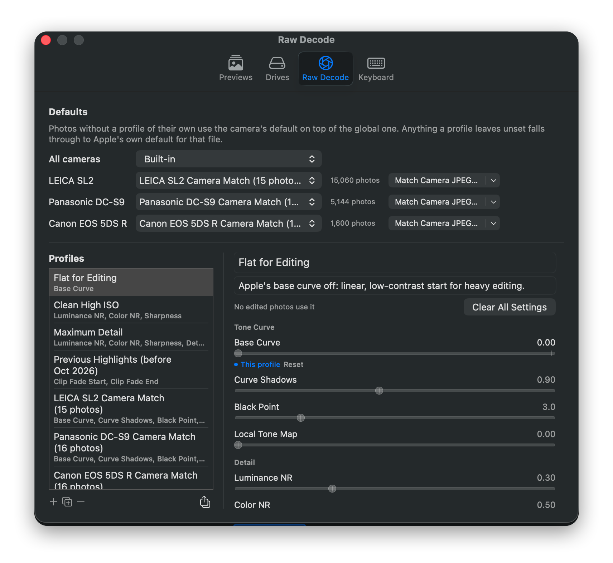
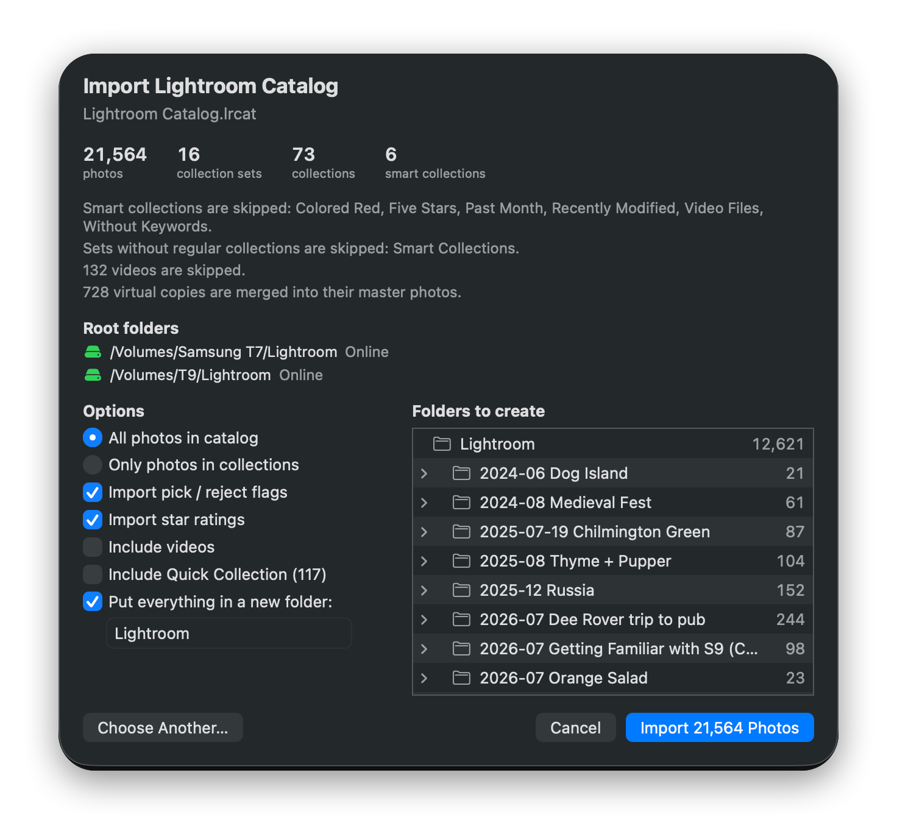
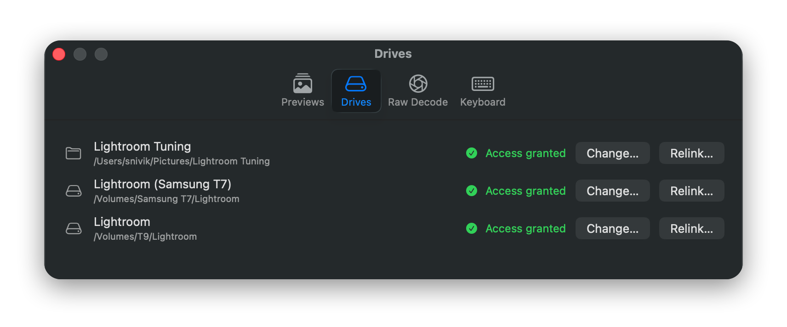

# Sloproom

<p align="center"></p>

> **Alpha.** Sloproom is a personal project under active development. Back up your catalog
> (File → Export Catalog) before updating.

> [!WARNING]
> **macOS will say it "could not verify Sloproom".** Release builds are signed by the developer but not
> notarized by Apple (that needs a Developer ID distribution setup this hobby project doesn't have). Pick one:
> - **Use the release build:** after the warning, choose System Settings → Privacy & Security → **Open Anyway**
>   (once per download). See [Install](#install).
> - **Build it yourself** from source and sign it on your own Mac. See [Build it yourself](#build-it-yourself).

## What is it

A native, non-destructive Mac photo editor built on Apple's RAW image processing framework, the one that comes
with every Mac. It gives you advanced control over RAW processing with familiar controls, plus extra features to
supercharge your workflows. It weighs next to nothing, runs natively and efficiently, and is free of charge.

## Motivation

Like [LightCraft](https://github.com/storytold/lightcraft), a project I highly respect, I don't see why I should
pay an expensive subscription for a poorly optimised, monopoly-controlled app. Unlike LightCraft, I'm happy to
give up cross-platform support to keep a native macOS feel and to lean on Apple's vast RAW layer, which handles
the most expensive part of image processing for me. The philosophy is to focus on one app on one platform and
get it right.

## Features

### Develop

Edit with the controls you already know:
- white balance;
- exposure, contrast, highlights, shadows, whites and blacks;
- texture, clarity, dehaze, vibrance and saturation;
- a colour mixer (hue, saturation and luminance per colour);
- vignetting and grain;
- crop and straighten;
- linear, radial and brush masks.

 The sliders are calibrated against Lightroom's on the same files, so they move the way you expect.

- **Non-destructive:** edits live in the catalog; your original files are never touched.
- **Fast to work with:**
  - zoom and pan with pinch, smart magnify or the keyboard;
  - a full-screen preview, and Tab to hide the panels;
  - recently edited photos open instantly, and the next ones are prepared ahead of time.
- **Edit many photos at once:** copy, paste and sync settings across any number of photos, undone in one step.
  Virtual copies let you try a different look on the same file.

### RAW decoding, under your control

<p align="center">
  
  
</p>

Sloproom uses Apple's RAW engine, the same camera database and demosaicing every Mac app gets, and exposes the
settings most apps hide:
- the base tone curve and black point;
- noise reduction, sharpening and detail;
- moiré reduction, lens correction and highlight handling.

- **Profiles, layered:** set them for all cameras, per camera, or per photo. Every value shows where it comes
  from, and every setting explains itself on hover.
- **Match Camera JPEG:** builds a profile for your camera by fitting it to the JPEGs the camera embedded in your
  own RAW files. It skips dark, blown-out or heavily styled frames, so any camera starts out looking like itself.
- **Share and compare:** profiles can be exported and imported, and each run of Match Camera JPEG makes a new
  profile.

### Organise

- **Sources:** folders (nested collections), a Dates section by year and month, and picks, rejects and star
  ratings.
- **Tags on photos and folders:** each tag has a colour and its own values, e.g. Blurry: true / false or
  Client: Anna / Ben.
  - Each value remembers who set it: you, or a workflow.
  - Values a workflow suggested sit in To Review until you confirm or change them. Hand off the dull first pass,
    then review a small set instead of everything.
- **One filter:** flags, ratings and tags share the same menu, and active filters show as chips. The folder list
  has its own filter by name and tag.
- **Sidebar:** every section can be hidden.

### Bring your Lightroom library

<p align="center"></p>

Point Sloproom at a Lightroom Classic catalog and it brings in your photos where they already are on disk:
- collections become folders;
- pick and reject flags and star ratings come along;
- virtual copies merge into their masters.

Lightroom edits aren't imported. Sloproom can also import from cards and folders, with a review page that spots
duplicates and asks before overwriting anything.

### Your drives, your permissions

<p align="center"></p>

Sloproom is sandboxed. It sees only the folders and drives you grant, and Settings › Drives shows each one. When
a drive is renamed or files move, Relink points the catalog at the new place. The whole catalog can be exported
and imported, with automatic backups.

### And

- JPEG export of finished photos, keeping their metadata.
- Every keyboard shortcut can be changed, and controls have tooltips.

See [CHANGELOG.md](CHANGELOG.md) for what's in each release.

## Install

1. Download the latest `Sloproom-<version>-alpha-universal.zip` from
   [Releases](https://github.com/Snivik/Sloproom/releases). It runs on Apple Silicon and Intel with macOS 15 or later.
2. Unzip it and move `Sloproom.app` to Applications.
3. The app isn't notarized, so macOS blocks the first launch. Open it once, then choose
   System Settings → Privacy & Security → **Open Anyway**. You can also run this instead:

```bash
xattr -dr com.apple.quarantine /Applications/Sloproom.app
```

### Build it yourself

You need Xcode 27 on macOS 15 or later.

- **In Xcode:** open `sloproom.xcodeproj`. Under the sloproom target › Signing & Capabilities, pick your own team
  (a free Apple account works) or "Sign to Run Locally", then choose Product › Run.
- **From the command line:** this makes an ad-hoc signed universal app and zip in `build/<version>/`:

```bash
SIGN_IDENTITY=- Tools/build_release.sh 0.2.0
```

A build you make on your own Mac opens without the warning.

## Releases

Every push to `main` runs the tests on GitHub Actions ([.github/workflows/ci.yml](.github/workflows/ci.yml)).

- **Releasing:** when the push adds a new version section at the top of [CHANGELOG.md](CHANGELOG.md), CI does three things:
  - builds the universal app;
  - tags it `v<version>`;
  - publishes a pre-release that uses that section as its notes.
- **Versions:** fix releases bump the patch (0.1.0 → 0.1.1); significant new features bump the minor (→ 0.2.0).
  - `Tools/changelog.sh next` (or `next minor`) prints the next version.
  - Pushes without a new section only run the tests.
- **Building locally:** `Tools/build_release.sh <version>` makes the same zip in `build/<version>/`.

Signing: releases are signed with the owner's Apple Development certificate when the `SIGNING_CERT_P12` and
`SIGNING_CERT_PASSWORD` repository secrets are set, the same as local builds. If they aren't set, releases
are signed ad hoc.

## Development

- **Building:** open `sloproom.xcodeproj` in Xcode, or see [docs/ARCHITECTURE.md](docs/ARCHITECTURE.md#build).
- **Tests:** headless checks are compiled from the app sources. See [Tools/README.md](Tools/README.md).
  - `Tools/ci_checks.sh` runs the checks that need no sample photos.
- **Screenshots:** the images in `docs/screenshots/` are cropped to the window, given rounded corners and a
  shadow with `Tools/polish_screenshot.swift`.
- **Ideas:** see [docs/IDEAS.md](docs/IDEAS.md).
